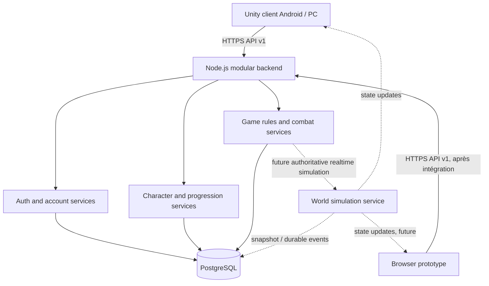

# ASTREA — Architecture technique cible
Version 1.0 — 15 novembre 2026
Statut : proposition d'architecture pour validation ; ce document ne décrit pas une infrastructure déjà déployée.

## 1. Objectifs et contraintes
- Construire un client 3D natif avec Unity 6.3 LTS et URP.
- Préserver le prototype navigateur et le backend Node.js/PostgreSQL pendant la transition.
- Concevoir les règles sensibles pour une validation serveur : combat, progression, inventaire, économie, territoires et identité.
- Priorité de validation actuelle : Android ; desktop ensuite. Les consoles et iOS restent des cibles à qualifier.
- Utiliser des outils et ressources gratuits lorsque possible. Aucun abonnement, hébergement payant, achat ou facturation automatique sans accord explicite.
- Ne pas confondre capacité de développement gratuite et exploitation gratuite : un MMORPG persistant nécessite calcul, stockage, réseau, sauvegardes, sécurité et supervision.

## 2. Architecture logique
### 2.1 Client Unity
Responsabilités :
- rendu 3D, caméra, interface, audio et contrôles ;
- présentation des personnages, animations, effets et environnements ;
- prédiction visuelle locale lorsque cela améliore la réactivité ;
- envoi d'intentions d'action au serveur et affichage des résultats autoritaires ;
- cache temporaire des contenus et données non sensibles.

Le client ne décide jamais seul de la propriété d'un objet, d'un résultat de combat, d'une récompense, d'un solde, d'une progression ou d'une action politique.

### 2.2 Services de compte et de métadonnées
Responsabilités proposées :
- inscription, authentification, sessions et récupération de compte ;
- profils, personnages, pseudonymes et paramètres ;
- inventaire persistant, quêtes, progression et données de compte ;
- API HTTPS versionnée et contrôle d'accès.

Le backend Node.js existant est une base de travail à auditer et à faire évoluer. Il n'est pas considéré comme un service de production tant que les adaptateurs PostgreSQL, les tests de sécurité et le déploiement ne sont pas validés.

### 2.3 Serveur de simulation temps réel
Responsabilités :
- autorité sur les déplacements et interactions critiques ;
- simulation des combats, dégâts, soins, états, projectiles et cooldowns ;
- validation des gains XP, maîtrises, butins et récompenses ;
- synchronisation des joueurs présents dans une zone ;
- arbitrage des transactions et des actions concurrentes.

Proposition : isoler la simulation temps réel dans un service dédié, distinct des API de compte. Le protocole réseau, la technologie serveur et le découpage en zones ne sont pas encore choisis. La décision doit être prise après un prototype de deux joueurs et des mesures de latence.

### 2.4 Persistance
PostgreSQL est la base relationnelle candidate pour les comptes, personnages, inventaires, quêtes, transactions et territoires. Les écritures sensibles doivent être transactionnelles, idempotentes et journalisées. Les sauvegardes doivent être chiffrées, testées en restauration et conservées selon une politique documentée.

Les données de simulation éphémères (positions, états fréquents) ne doivent pas provoquer une écriture SQL à chaque image. Définir des instantanés, événements et sauvegardes périodiques selon les besoins réels.

### 2.5 Contenu et distribution
- Assets source : Blender (.blend), textures sources, fichiers de référence et licences.
- Échange : GLB/glTF pour inspection et transport ; FBX seulement lorsqu'il est nécessaire au pipeline Unity.
- Client : assets importés et Addressables locaux au départ.
- Distribution distante/CDN : option future, uniquement après comparaison des coûts, de la sécurité et des besoins de mise à jour.

## 3. Flux de données critique
1. Le joueur envoie une intention (se déplacer, attaquer, lancer un sort, échanger).
2. Le client peut jouer une réponse visuelle provisoire.
3. Le serveur vérifie identité, état, portée, cooldown, ressources, règles de race et contexte.
4. Le serveur calcule le résultat et l'enregistre lorsque l'action modifie un état persistant.
5. Le serveur diffuse le résultat confirmé aux clients concernés.
6. Le client corrige sa prédiction si le résultat autoritaire diffère.

Les transactions d'inventaire et de monnaie doivent utiliser des identifiants uniques et empêcher les doubles exécutions lors d'une reconnexion ou d'une répétition de requête.

## 4. Domaines métier et frontières
| Domaine | Autorité | Données principales |
|---|---|---|
| Compte/session | Service compte | identité technique, session, sécurité |
| Personnage | Service persistance | race, apparence, nom, pseudonyme |
| Combat | Serveur de simulation | santé, dégâts, effets, cooldowns |
| Progression | Serveur + persistance | niveau, XP, statistiques, maîtrises |
| Inventaire | Service transactionnel | objets, équipements, stockage |
| Économie | Service transactionnel | soldes, prix, échanges, taxes |
| Monde | Simulation + persistance | zones, ressources, états persistants |
| Territoires | Service métier | propriétaires, rôles, budgets, lois |
| Social/modération | Services dédiés | amis, groupes, signalements, sanctions |

Ces frontières sont logiques ; elles ne signifient pas qu'il faut créer immédiatement un microservice par domaine. Commencer avec un monolithe modulaire est recommandé jusqu'à ce que les mesures justifient une séparation.

## 5. Sécurité et résilience
- Authentification sécurisée, secrets uniquement côté serveur.
- Validation stricte des entrées, limites de débit et protections contre rejeu.
- Autorité serveur sur les actions qui ont une valeur de jeu.
- Journal d'audit pour transactions, sanctions, gouvernance et changements administratifs.
- Sauvegardes automatisées et exercices de restauration.
- Gestion des déconnexions, reconnexions, reprise de session et opérations idempotentes.
- Minimisation des données personnelles et politique de conservation à définir.
- Modération, blocage, signalement et outils d'administration avant ouverture publique.

## 6. Performance et montée en charge
Ne pas dimensionner sur l'objectif d'un million de comptes inscrits. Mesurer séparément :
- comptes enregistrés ;
- joueurs simultanés par monde ;
- joueurs simultanés par zone ;
- fréquence des mises à jour ;
- trafic entrant/sortant ;
- temps de réponse API ;
- mémoire et CPU par instance ;
- taux de reconnexion et pertes de paquets.

Proposition de progression des tests : 2 joueurs, 10, 25, 50, puis paliers supérieurs seulement si les mesures le permettent. Les limites par zone et le modèle de transfert entre zones doivent être décidés après les tests. Aucun chiffre de capacité de production n'est garanti aujourd'hui.

## 7. Architecture client et performance mobile
- URP avec profils qualité séparés par catégorie d'appareil.
- LOD, occlusion, instancing, Addressables et streaming par zones lorsque le contenu le justifie.
- Limiter ombres temps réel, particules, transparences et matériaux coûteux sur Android.
- Résolution dynamique et plafonds d'effets à évaluer sur appareil réel.
- Input System unifié pour tactile, manette, clavier/souris.
- Scènes et assets chargés progressivement ; éviter le chargement intégral du monde.

Les budgets chiffrés (FPS, mémoire, draw calls, taille de téléchargement) seront fixés après mesure sur appareils de référence, pas inventés à ce stade.

## 8. Environnements de développement
- Local/cloud : Unity 6.3 LTS, Blender, GitHub.
- CI : validation des métadonnées, tests unitaires disponibles, tests navigateur existants, vérification des exports Blender.
- Unity Editor/Android : workflow cloud seulement si la licence Unity et l'environnement sont disponibles ; un runner standard ne prouve pas une compilation Unity.
- Développement réseau : serveur local ou environnement de test gratuit contrôlé ; aucun service public payant n'est activé automatiquement.

## 9. Décisions techniques encore ouvertes
1. Technologie et protocole du serveur temps réel.
2. Modèle de zones, instances et transferts entre continents.
3. Cible simultanée du premier test réseau et du premier lancement.
4. Schéma de persistance et stratégie d'événements/sauvegardes.
5. Authentification, récupération de compte et politique de données.
6. Stratégie d'hébergement gratuite pour prototype et financement éventuel de production.
7. Plateformes de sortie prioritaires et contraintes de certification.

## 10. Critères d'acceptation de l'architecture
- Diagramme des flux client/API/simulation/base de données approuvé.
- Toutes les actions sensibles ont une autorité clairement désignée.
- Un scénario à deux clients démontre la synchronisation et la résolution serveur.
- Les données persistantes survivent à une déconnexion et à un redémarrage.
- Les tests de transaction empêchent duplication/perte d'objets ou de monnaie.
- Les coûts et limites des environnements sont documentés avant tout déploiement public.
- Les limites de capacité sont appuyées par des mesures reproductibles.

---
**Statut de sortie :** proposition prête pour revue. La mise en œuvre technique et le choix final du protocole sont volontairement réservés à la phase de développement.

## 11. Audit du dépôt et décisions de phase 3
Audit documentaire du dépôt `feat/blender-unreal-cloud-pipeline`, 15 novembre 2026.

### 11.1 Éléments réellement présents
- Client 3D : projet Unity 6.3 LTS, URP 17.3.0, Input System, Cinemachine, Animation Rigging et Addressables déclarés dans le manifeste.
- Backend : application Node.js en modules ES, Node.js >=22, démarrage par `server/index.js`.
- API : serveur HTTP versionné sous `/v1`, services séparés par responsabilités (authentification, personnages, progression, combat magique).
- Données : dépendance PostgreSQL `pg`, repository SQL et quatre migrations de compte/session, personnage/progression d'armes, progression magique et état de combat magique.
- Sécurité déjà décrite dans le serveur : mots de passe scrypt + sel, jetons de session opaques dont seul le SHA-256 est stocké, rattachement des personnages au compte authentifié, progression accordée par les services internes.
- CI : tests Node et tests navigateur existent dans les scripts racine.

### 11.2 Limites constatées
- Le backend ne constitue pas un serveur de simulation MMORPG temps réel.
- Le service de combat magique indique que les cibles offensives nécessitent encore un résolveur appartenant au serveur de monde ; il refuse ces cibles tant que ce composant n'est pas branché.
- Le prototype navigateur n'est pas encore relié aux routes du backend, d'après le README serveur.
- Aucun protocole temps réel, système de zones, transfert entre zones, déploiement de production, sauvegarde restaurable ou capacité simultanée n'est validé par cet audit.
- La présence de dépendances Unity dans le manifeste ne prouve pas qu'une compilation Unity ou un build Android a été exécuté.
- La disponibilité d'une base PostgreSQL dans un environnement de test n'est pas prouvée par le seul code du repository.

### 11.3 Décisions de conception retenues pour le prototype
1. Garder Unity comme client 3D principal et préserver le prototype navigateur pendant la transition.
2. Garder Node.js comme backend applicatif et PostgreSQL comme stockage persistant candidat.
3. Organiser le backend en monolithe modulaire. Ne pas créer un microservice par domaine avant d'avoir une mesure qui justifie cette séparation.
4. Garder le serveur autoritaire pour identité, combat, progression, inventaire et économie. Le client transmet des intentions, jamais des résultats de jeu à valider aveuglément.
5. Ne pas choisir encore le protocole de simulation temps réel. Comparer les options lors d'un prototype réseau à deux clients, avec mesure de latence, fréquence d'updates, pertes et charge CPU.
6. Ne pas engager d'hébergement payant. Les essais utilisent un environnement local ou cloud gratuit, réversible et sans données de production ; toute dépense future nécessitera l'accord explicite du créateur.
7. Dimensionner d'abord sur un test reproductible à deux clients, puis 10, 25 et 50 si les résultats le permettent. Le million de comptes inscrits reste un objectif distinct du nombre de joueurs simultanés.

### 11.4 Schéma logique de référence

Ce schéma décrit une cible logique et des intégrations futures ; les flèches pointillées ne sont pas des fonctions actuellement déployées.

### 11.5 Critères de sortie de la phase 3
- [x] Client Unity, backend Node.js et stockage PostgreSQL candidat identifiés.
- [x] Frontières initiales des responsabilités et autorité serveur documentées.
- [x] Architecture simple de prototype retenue, sans microservices prématurés.
- [x] Contraintes de coût et interdiction de dépense sans accord documentées.
- [ ] Protocole temps réel choisi après prototype comparatif à deux clients.
- [ ] Connexion réelle du client Unity à l'API et test d'authentification.
- [ ] Test de persistance PostgreSQL, redémarrage et restauration.
- [ ] Démonstration réseau à deux clients avec serveur autoritaire.
- [ ] Mesures reproductibles de latence, charge et synchronisation.

**Statut de phase :** architecture logique initiale définie et auditée ; phase 3 non entièrement validée tant que les tests d'intégration et le prototype réseau ne sont pas passés. Les éléments cochés sont des décisions documentées, pas des validations d'infrastructure de production.

### 11.6 Audit du raccordement Unity ↔ API
- Le dépôt contient déjà `unity/Assets/Scripts/Networking/AstreaApiClient.cs`.
- Le client Unity expose l'inscription, la connexion, la liste/création de personnages et la déconnexion via les routes `/v1`.
- Le jeton Bearer est conservé en mémoire et le commentaire du code précise qu'il n'est pas écrit dans PlayerPrefs.
- Les routes de progression et de combat magique existent côté Node.js, mais le client Unity audité ne les expose pas encore dans cette classe.
- L'URL par défaut est `http://127.0.0.1:3000`. Sur un téléphone Android, cette adresse désigne le téléphone lui-même, pas le serveur hébergé ailleurs. Il faudra configurer l'adresse LAN de la machine de test ou l'URL HTTPS du serveur de test avant tout essai mobile.
- Le code présent prouve l'existence d'un adaptateur API, pas qu'une connexion réelle depuis Unity a été exécutée. Aucun test d'intégration Unity ↔ PostgreSQL n'est déclaré réussi à ce stade.

### 11.7 Contrôles à compléter avant une exposition réseau
- Ajouter une limitation de débit pour l'inscription, la connexion et les routes sensibles.
- Imposer HTTPS hors environnement local de développement.
- Ajouter des tests automatisés sur les limites de taille, les erreurs JSON, les jetons invalides, les accès inter-comptes et les requêtes répétées.
- Vérifier le cycle de vie des sessions et le traitement des erreurs de base de données.
- Définir les origines autorisées uniquement si le navigateur prototype doit appeler directement l'API depuis un autre domaine ; ne pas activer un CORS permissif par défaut.

### 11.8 Contrats HTTP couverts par tests automatisés
Le fichier `tests/server-http-api.test.js` ajoute des tests HTTP exécutant le vrai serveur Node.js sur un port local avec services simulés :
- inscription et connexion : codes HTTP et forme de réponse ;
- routes personnages : authentification obligatoire et propriétaire dérivé du jeton, pas du corps client ;
- déconnexion : transmission du jeton au service de révocation ;
- JSON invalide et corps supérieur à la limite : rejet contrôlé.

Ces tests vérifient les routes et leurs contrats avec des dépendances simulées. Ils ne remplacent pas un test de bout en bout avec une vraie base PostgreSQL, ni un test du client Unity. La suite serveur et gameplay a réussi sur le commit `1f3844b`; le test Chromium de ce commit est encore en cours au moment de cette mise à jour.

### 11.9 Test d'intégration PostgreSQL ajouté
- Le workflow CI démarre désormais un service PostgreSQL 16 éphémère.
- `tests/postgres-integration.test.js` applique les quatre migrations sur cette vraie instance et vérifie inscription/connexion, sessions, création et isolement des personnages, persistance JSONB, transaction et rollback.
- Le test est ignoré localement si `DATABASE_URL` n'est pas fourni ; dans GitHub Actions, le service PostgreSQL est configuré pour que le test s'exécute.
- Cette validation porte sur le backend et la base dans le runner CI. Elle ne prouve pas encore le raccordement du client Unity, ni une base de production ou un serveur multijoueur temps réel.
