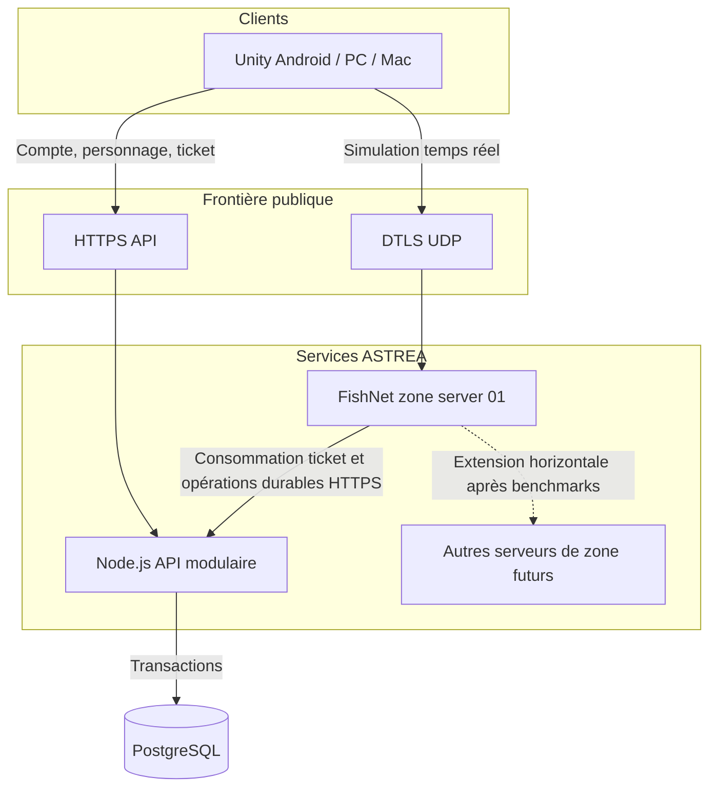

# ASTREA — rapport de faisabilité technique, étape 3

Date de référence : 21 novembre 2026  
Statut : **architecture et fondation PostgreSQL de reprise de zone implémentées ; validation Unity réelle encore ouverte**  
Branche d'investigation réseau : `spike/fishnet-unity-6-3-evaluation`

## 1. Objet de l'étape

L'étape 3 doit démontrer que les exigences d'ASTREA peuvent être traduites en une architecture cohérente, mesurable, sécurisable et évolutive, sans engager de dépenses prématurées. Elle ne consiste pas à produire les modèles 3D ou le contenu final : ces travaux appartiennent aux étapes suivantes.

Ce rapport distingue :
- ce qui existe dans le dépôt et a été testé ;
- les décisions retenues pour le prototype ;
- les hypothèses encore non démontrées ;
- les portes qui empêchent de déclarer l'étape terminée.

## 2. Faisabilité générale

| Domaine | Évaluation | Décision |
|---|---|---|
| Client 3D Unity | Faisable, compilation exacte non encore prouvée | Unity 6.3 LTS + URP, Android en première cible de validation |
| PC / Mac | Faisable sous réserve des builds et profils qualité | Même client Unity, contrôles clavier/souris et manette |
| iPhone / iPad | Faisable sous réserve de build, signatures et tests physiques | À qualifier après la chaîne Android |
| PS4 / PS5 / Switch 2 | Conditionnel | Kits, accès éditeur, SDK et certifications requis ; aucune compatibilité garantie par le prototype |
| Backend comptes et progression | Fondation présente et testée en CI | Node.js 22+ modulaire, API HTTPS versionnée |
| Stockage persistant | Fondation PostgreSQL testée en CI | PostgreSQL transactionnel pour données durables |
| Multijoueur temps réel | Architecture de prototype définie, intégration FishNet non compilée | FishNet 4.7.4 sur branche isolée, serveur Unity dédié à qualifier |
| Monde persistant de grande échelle | Faisable par étapes, non démontré | Zones/instances, streaming et sauvegardes ; aucune capacité chiffrée promise |
| Un million de comptes inscrits | Objectif d'architecture, pas une charge simultanée | Royaume logique réparti sur plusieurs processus/zones |
| 40–60 FPS | Objectif de qualité, pas une mesure | Profils Android/PC et tests sur appareils physiques obligatoires |
| Production sans aucun coût | Non réaliste | Prototype sans facturation automatique ; production nécessitera calcul, réseau, stockage, sécurité et exploitation |

## 3. Architecture cible du prototype

### Client
Unity 6.3 LTS et URP gèrent le rendu, l'interface, les contrôles, les animations, les effets et la présentation. Le client envoie des intentions ; il ne décide pas des résultats sensibles.

### API applicative
Node.js 22+ reste le service de comptes, sessions, personnages, progression, règles métier et émission des tickets. L'API reste un monolithe modulaire au début. Aucun microservice n'est ajouté sans mesure qui justifie sa séparation.

### Simulation temps réel
FishNet 4.7.4 est le framework retenu pour le prochain prototype de serveur Unity dédié. Le serveur de zone sera autoritaire sur les déplacements validés, combats, dégâts, soins, ressources et récompenses. La dépendance n'est déclarée que sur la branche d'évaluation.

Le prototype Node WebSocket reste une référence de comparaison. Il ne partage pas le même transport ni le même handshake que FishNet.

### Vue logique des flux

Le serveur Node est l'autorité pour les comptes et les données persistantes ; FishNet est l'autorité pour la simulation d'une zone en temps réel. La connexion client/zone passe par DTLS, l'appel serveur/Node par HTTPS. Le schéma multi-zone est la cible d'architecture, pas une capacité déjà déployée.

### Persistance
PostgreSQL stocke les comptes, sessions, personnages et états durables. Les positions et états de simulation très fréquents restent en mémoire sur le serveur de zone. Les sauvegardes persistantes doivent être transactionnelles, idempotentes et restaurables.

Le serveur Unity ne doit pas écrire une ligne SQL à chaque image ou tick. Il doit passer par des opérations internes contrôlées pour les changements durables.

### Authentification réseau
Le client demande un ticket de 30 secondes après authentification HTTP. Le ticket est opaque, lié au compte, au personnage et au serveur cible ; seul son hash SHA-256 est stocké. Le serveur Unity le consomme une seule fois via une route Node interne protégée par secret serveur. Le jeton Bearer de compte ne transite jamais dans FishNet.

La route Node, la migration PostgreSQL, l'adaptateur HTTP Unity, l'Authenticator FishNet et le spawner conditionnel sont présents sur la branche isolée. La compilation et l'exécution réelle de ces composants restent à prouver.

## 4. Modèle de monde et montée en charge

Le monde ne doit pas être chargé comme une seule scène géante. Les continents et régions sont divisés en cellules/secteurs streamés, avec des instances pour les lieux ou événements nécessitant une population distincte.

Un « serveur » au sens du créateur désigne un royaume logique pouvant contenir de nombreux processus de zone. Il ne désigne pas un seul processus Unity capable de gérer un million de connexions simultanées.

Stratégie d'évaluation :
1. Deux clients sur une même zone.
2. Dix clients.
3. Vingt-cinq clients.
4. Cinquante clients.
5. Augmenter uniquement si les paliers précédents restent stables.

Chaque palier doit relever CPU, RAM, bande passante entrante/sortante, taille des snapshots, fréquence d'updates, latence p50/p95/p99, déconnexions, reconnexions et taux de rejet des entrées invalides. Les résultats loopback CI ne sont pas transposables au WAN.

La séparation des zones et le transfert entre zones sont des besoins d'architecture futurs, mais ne doivent pas être implémentés avant de connaître la charge et le modèle de visibilité réels.

## 5. Données et précision numérique

Les règles de progression d'ASTREA prévoient des statistiques pouvant atteindre 10 milliards. Un entier signé 32 bits ne suffit pas.

Décisions à préserver :
- niveau et compteurs bornés : type entier adapté à leur plage ;
- XP, monnaie, statistiques, dégâts cumulés et valeurs persistantes pouvant dépasser 2 147 483 647 : entier 64 bits côté C# (`long`) et `BIGINT` côté PostgreSQL ;
- ne pas utiliser `float` ou `double` pour les soldes, prix ou transactions financières ;
- stocker les monnaies en unités entières minimales ; utiliser une arithmétique décimale contrôlée pour les taux de conversion ;
- les valeurs de gameplay envoyées par le client sont des intentions, jamais une preuve de dégâts, de récompense ou de solde.

Ces règles devront être reflétées dans les schémas, sérialiseurs réseau, calculs de combat et tests de limites avant d'implémenter les systèmes économiques complets.

## 6. Exigences non fonctionnelles

- **Sécurité :** HTTPS hors boucle locale, secrets hors dépôt, tickets à usage unique, validation serveur, contrôle d'accès par propriétaire, limites de débit distribuées avant exposition publique, protection contre le rejeu et journaux sans jetons.
- **Persistance :** migrations versionnées, transactions, idempotence, sauvegardes chiffrées, restauration périodiquement testée et politique de rétention à définir.
- **Mobile :** URP, streaming, LOD, limitation des ombres/particules, profils qualité et tests sur téléphones de référence. Le navigateur mobile n'est pas une preuve de performance Unity native.
- **Réseau :** interpolation/prédiction à limiter au visuel ; l'autorité de simulation reste serveur.
- **Observabilité :** métriques par zone, journaux structurés, alertes, suivi des erreurs et outils d'administration avant bêta publique.
- **Économie :** journal de transactions et protections contre double dépense, duplication et rejeu.
- **Monde persistant :** sauvegarde/reprise, versionnement des données et migration sans effacer les royaumes.
- **Coûts :** aucune infrastructure payante ni facturation automatique sans accord explicite. L'absence de coût du framework ne signifie pas absence de coût d'hébergement.

Le modèle de menace détaillé est conservé dans [docs/network-security-threat-model.md](network-security-threat-model.md). La stratégie de snapshots, journal durable et reprise après crash est décrite dans [docs/zone-persistence-recovery.md](zone-persistence-recovery.md), mais n'est pas encore implémentée. Il sépare les actifs, frontières de confiance, contrôles testés et risques restant à traiter avant exposition Internet.

## 7. Registre des risques

| Risque | Gravité | État / réponse |
|---|---|---|
| FishNet n'a pas encore été résolu par Unity | Élevée | Dépendance UPM épinglée ; résolution Editor obligatoire |
| Projet Unity non compilé sous 6000.3.28f1 | Élevée | Workflow de build licencié existant ; exécution encore nécessaire |
| Authenticator FishNet non compilé | Élevée | API exacte du tag 4.7.4 contrôlée par CI source ; compilation Editor toujours requise |
| Prefab NetworkManager et prefab joueur non configurés | Élevée | Spawner source ajouté ; scène et prefab réseau restent à créer/valider |
| Deux clients FishNet pas encore testés | Élevée | Critère bloquant de sortie |
| Performance WAN / Android inconnue | Élevée | Tests distants et appareil physique obligatoires |
| Transport FishNet par défaut non chiffré | Élevée | FishyUnityTransport 2.0.0-pre.2 + UTP 2.7.5 ajoutés à la branche isolée ; DTLS configuré en code et scénario CI préparé, résolution/compilation Unity et handshake certifié encore à prouver |
| Capacité à grande échelle inconnue | Élevée | Ne pas annoncer de CCU avant benchmarks progressifs |
| Licence FishNet personnalisée | Moyenne | Revue différée selon la décision du créateur, à effectuer avant distribution publique |
| Consoles et certifications | Élevée | Dépend d'accès éditeur et SDK, hors preuve actuelle |
| Coût d'exploitation de production inconnu | Élevée | Modèle de charge et devis à établir avant déploiement public |

## 8. Preuves déjà obtenues

- Tests serveur, gameplay, HTTP, PostgreSQL 16, sauvegarde/restauration et Chromium desktop/mobile réussis dans GitHub Actions.
- Prototype Node WebSocket à deux clients avec état de déplacement autoritaire et rejet d'entrées invalides.
- Benchmark Node loopback et simulation applicative de délai/gigue/suppression de snapshots exécutés en CI. Ces résultats ne simulent pas une perte de paquets IP et ne mesurent pas le WAN.
- Tickets FishNet : tests d'émission, liaison au personnage, stockage du hash, rejeu, serveur cible, expiration, consommation concurrente atomique et purge de rétention testés.
- Contrôles de source Unity et de métadonnées exécutés dans le workflow Unity Foundation.
- Compilation .NET des scripts API client, Authenticator, configurateur DTLS, PlayerSpawner, NetworkTestPlayer et NetworkTestClient contre des stubs isolés ; signatures API du tag FishNet 4.7.4 vérifiées par assertions CI.
- Configuration DTLS serveur/client exercée par tests .NET avec fausses clés/certificats ; code FishyUnityTransport 2.0.0-pre.2, méthodes DTLS, licence MIT et branche UTP 2.x vérifiés dans GitHub Actions. Ceci ne remplace pas un vrai handshake Unity.
- Test exécuté en CI de la validation des URL API : HTTPS distant accepté, HTTP loopback accepté pour le développement, HTTP distant et URL avec identifiants/chemin/query/fragment rejetées. Workflow Unity Foundation réussi le 21 novembre 2026 (run 44887759276).
- Le workflow d'intégration deux clients s'arrête à la vérification du secrets `UNITY_LICENSE`, `UNITY_EMAIL` et `UNITY_PASSWORD` absents ; aucune compilation Unity ni session deux clients n'a donc été exécutée.
- Suite complète Node/PostgreSQL/backup-restore/benchmarks/Chromium, incluant la migration 005 et la purge des tickets, réussie dans le workflow [44889120732](https://github.com/debsboni7-dot/Astra-MMORPG/actions/runs/44889120732).
- Suite CI complète réussie sur le commit `9de1d4e0d4436ac36ba2051cd2c4c0a839f5af92`, workflow [44890719641](https://github.com/debsboni7-dot/Astra-MMORPG/actions/runs/44890719641) : tests Node, intégration PostgreSQL, migration 006, reprise de zone snapshot + journal, fencing, 24 événements concurrents, sauvegarde/restauration avec données de zone, benchmarks réseau et Chromium desktop/mobile.
- Les lectures de reprise exigent maintenant le bail actif et l'epoch courant ; les contrôles d'expiration utilisent `clock_timestamp()` pour éviter qu'une transaction ayant attendu un verrou puisse accepter un bail expiré.
- Le workflow de vérification source peut comparer les API utilisées avec le tag FishNet 4.7.4 exact ; cela ne remplace pas le compilateur Unity.

## 9. Portes obligatoires avant clôture de l'étape 3

- [x] Architecture logique client / API / simulation / persistance documentée.
- [x] Responsabilités serveur autoritaire et frontières des domaines définies.
- [x] Interprétation de l'objectif d'un million de comptes clarifiée.
- [x] Politique de coûts sans dépense automatique documentée.
- [x] Prototype Node WebSocket à deux clients testé.
- [x] Tickets FishNet durables, à usage unique et liés au serveur testés côté Node/PostgreSQL.
- [x] Purge périodique des tickets consommés/expirés ajoutée, avec index PostgreSQL et tests Node/PostgreSQL.
- [x] Adaptateur Unity pour demander le ticket ajouté.
- [x] Authenticator FishNet et point de spawn serveur ajoutés en code sur branche isolée.
- [x] Contrat API FishNet 4.7.4 vérifié statiquement dans CI.
- [x] FishyUnityTransport 2.0.0-pre.2 et Unity Transport 2.7.5 ajoutés au manifeste de la branche isolée uniquement.
- [x] Composant Unity qui force DTLS et lit certificat/clé serveur depuis l'environnement ajouté.
- [x] Tests .NET du configurateur DTLS serveur/client exécutés en CI.
- [x] Workflow deux clients adapté pour générer des certificats de test éphémères et tenter un handshake DTLS.
- [ ] Résolution réelle UPM et compilation Unity 6000.3.28f1 (bloqué par l'absence des secrets `UNITY_LICENSE`, `UNITY_EMAIL` et `UNITY_PASSWORD` dans GitHub Actions).
- [ ] Build Linux Dedicated Server réussi (même blocage de licence Unity).
- [ ] Configuration d'un NetworkManager et d'un prefab NetworkObject de test dans une scène.
- [ ] Connexion de deux clients Unity, authentification par ticket et spawn réciproquement visible (workflow prêt, non exécuté sans licence).
- [ ] Mesures FishNet comparables à la référence Node.
- [ ] Résoudre UPM et compiler FishyUnityTransport + Unity Transport 2.7.5 dans Unity 6000.3.28f1.
- [ ] Réussir le build serveur/client et le handshake DTLS avec validation du certificat dans le workflow deux clients.
- [ ] Test WAN et au moins un appareil Android physique.
- [x] Stratégie de persistance/reprise après crash de zone définie et documentée (journal idempotent, snapshots, lease/fencing).
- [x] Migration PostgreSQL 006, journal d'événements, snapshots, bail exclusif et fencing implémentés dans le dépôt.
- [x] Tests unitaires de validation des commandes de zone ajoutés.
- [x] Test PostgreSQL réel : récupération snapshot + événements, idempotence, crash simulé, nouvel epoch et rejet de l'ancien processus.
- [~] API interne de persistance branchée au bootstrap FishNet : bail exclusif acquis, récupération lue avant le démarrage réseau, renouvellement du bail et arrêt si perte/fencing. Événements de gameplay, snapshots périodiques et test de restauration d'un build dédié encore à faire.
- [x] Implémentation du journal, des snapshots, des baux et du fencing dans PostgreSQL ; scénario de reprise simulé et testé.
- [ ] Raccordement au processus Unity FishNet, puis test d'arrêt/redémarrage du build dédié.

## 10. Conclusion

L'architecture est suffisamment définie pour poursuivre l'intégration, et plusieurs risques backend ont été réduits par des tests réels PostgreSQL/Node. Toutefois, l'étape 3 **n'est pas terminée** : l'intégration FishNet n'a pas encore passé le compilateur Unity, le build serveur dédié et le scénario de deux clients Unity.

La prochaine tâche reste donc une validation technique Unity, pas le démarrage de l'étape 4. Les critères non cochés sont des preuves manquantes, pas des tâches que l'on peut remplacer par davantage de documentation. Pour débloquer les tests Unity cloud, il faut activer Unity Personal une fois dans Unity Hub, puis ajouter les trois secrets GitHub `UNITY_LICENSE`, `UNITY_EMAIL` et `UNITY_PASSWORD` comme décrit dans `docs/unity-ci-license-setup.md`, et relancer le workflow manuel avec confirmation explicite. Une machine temporaire empruntée suffit pour l'activation initiale ; les builds suivants se font dans GitHub Actions. Sans ce secret, aucune action côté code ne peut produire une compilation Unity authentique.

## Mise à jour build serveur dédié

Le projet contient maintenant un point d'entrée Unity Editor `AstreaCloudBuild.BuildLinuxDedicatedServer` qui demande explicitement le sous-cible `StandaloneBuildSubtarget.Server`, ainsi qu'un workflow manuel `.github/workflows/unity-linux-server-build.yml`. Le workflow exige `confirm_build=yes` et le secrets `UNITY_LICENSE`, `UNITY_EMAIL` et `UNITY_PASSWORD`, puis produit un artefact Linux Dedicated Server.

Le workflow est préparé, pas exécuté. Le dépôt ne prétend donc pas encore que le projet compile ou qu'un build serveur a réussi. La documentation Unity 6.3 confirme que le sous-cible Dedicated Server se sélectionne via `BuildPlayerOptions.subtarget = (int)StandaloneBuildSubtarget.Server`.

## Mise à jour — banc de test deux clients préparé

Un générateur de scène Unity Editor crée une scène de test séparée du jeu, avec le prefab NetworkManager FishNet 4.7.4, un prefab proxy de test (cube temporaire), un NetworkTransform configuré serveur-autoritaire, la collection de prefabs spawnables, l'Authenticator, le spawner et un client harness automatisé. Un workflow manuel construit le serveur Linux dédié et deux clients Linux, démarre PostgreSQL et Node, génère deux tickets, puis vérifie que le client 2 observe le mouvement envoyé par le client 1 et validé par le serveur.

Le workflow exige le secrets Unity Personal `UNITY_LICENSE`, `UNITY_EMAIL` et `UNITY_PASSWORD` et une confirmation manuelle. Il n'a pas été lancé. La scène et le test automatisé sont donc préparés, pas validés.

## 11. Cohérence budgétaire avec la référence de production

Le budget de référence conservé pour ASTREA est **2 000 000 EUR sur un prototype de 10 mois**. Il ne représente pas le coût total de réalisation et d'exploitation du MMORPG complet. La première estimation plus basse de 550 000 USD avait été rejetée comme insuffisante.

| Poste de référence | Montant |
|---|---:|
| Équipe de production | 1 150 000 EUR |
| Art, animation et audio | 300 000 EUR |
| Réseau et sécurité | 180 000 EUR |
| Logiciels et équipements | 90 000 EUR |
| QA et tests | 120 000 EUR |
| Juridique et recrutement | 60 000 EUR |
| Réserve | 100 000 EUR |
| **Total** | **2 000 000 EUR** |

Cette ventilation est une enveloppe de planification, pas encore un devis validé. Elle doit être rapprochée d'un organigramme réel, du coût chargé par rôle, du calendrier de recrutement et des livrables précis du prototype vertical. Le travail réseau de cette étape confirme aussi qu'il faut séparer :
- le budget de développement du prototype ;
- les coûts d'exploitation récurrents après lancement (serveurs de zones, base de données, bande passante, protection DDoS, sauvegardes, supervision, support et astreinte).

Les coûts d'exploitation ne sont pas chiffrés tant que la cible de joueurs simultanés, le nombre de régions, la densité des zones et les profils de charge ne sont pas mesurés. Un million de comptes inscrits ne suffit pas à calculer les serveurs nécessaires.

## 12. Résultats CI vérifiés sur le commit `a916d7ddc763c16fc96a1e35d4de580102da3338`

- Workflow serveur et prototype navigateur : **succès**, run [43832520144](https://github.com/debsboni7-dot/Astra-MMORPG/actions/runs/43832520144). Il inclut les tests Node, PostgreSQL, sauvegarde/restauration, exécution du runner de migrations, benchmark réseau applicatif et tests Chromium desktop/mobile.
- Workflow Unity Foundation : **succès**, run [43832520147](https://github.com/debsboni7-dot/Astra-MMORPG/actions/runs/43832520147). Il vérifie les API du tag FishNet 4.7.4, les valeurs par défaut serveur/transport, les métadonnées et compile les scripts runtime FishNet contre des stubs isolés.

Ces deux runs valident les parties qu'ils exécutent. Aucun des deux n'ouvre Unity Editor. Le workflow end-to-end avec licence Unity reste le seul moyen préparé dans le dépôt pour vérifier résolution UPM, compilation Unity, build Linux server/client, handshake DTLS et mouvement répliqué entre deux clients. La fondation de reprise PostgreSQL est désormais testée séparément dans la CI serveur.

## 13. Blocage Unity réel identifié

Le workflow end-to-end a bien été déclenché : [run 43832992881](https://github.com/debsboni7-dot/Astra-MMORPG/actions/runs/43832992881). Il s'est arrêté au contrôle préalable `Check Unity license secret`, car le secret de dépôt `UNITY_LICENSE` est absent. Aucun téléchargement de package Unity, aucune compilation Editor, aucun build Linux et aucun test à deux clients n'ont donc été tentés dans ce run.

Déblocage nécessaire : ajouter le contenu d'un fichier de licence Unity valide au secret GitHub Actions `UNITY_LICENSE` dans les paramètres du dépôt, puis relancer ce run. Ne jamais coller le contenu de la licence dans le code ou dans une conversation. La procédure actuelle d'activation Unity dépend du type de licence et peut nécessiter Unity Hub ; la voie d'activation manuelle Personal n'est pas garantie par Unity/GameCI.

## 14. Transport chiffré FishNet — 21 novembre 2026

FishyUnityTransport `2.0.0-pre.2` (MIT) et Unity Transport `2.7.5` sont maintenant épinglés dans le manifeste de la branche isolée. Le configurateur `AstreaFishNetTransportSecurity` force `UseEncryption`, charge le certificat et la clé privée du serveur depuis l'environnement, et configure le nom DNS/CA côté client. Le générateur de scène utilise ce transport au lieu de Tugboat.

Le workflow deux clients génère une CA et un certificat serveur temporaires avec SAN DNS localhost + IP 127.0.0.1, puis les passe au serveur et aux clients. Les secrets sont temporaires au runner et ne sont pas committés. Les tests .NET de configuration DTLS et les contrôles source sont exécutables sans Unity.

**État de preuve :** le transport chiffré est intégré au prototype, mais pas encore validé par Unity. La résolution UPM, la compilation Editor, le build Linux et le handshake DTLS restent bloqués par l'activation Unity Personal manquante. La porte de sortie de l'étape 3 reste donc ouverte.

### Rétention des tickets de connexion — 21 novembre 2026

Les tickets ne restent plus indéfiniment dans PostgreSQL. La migration `005_realtime_join_ticket_cleanup.sql` ajoute un index partiel sur les tickets consommés ; le dépôt fournit une purge des tickets consommés ou expirés depuis plus de cinq minutes. Le service déclenche cette purge tous les 100 tickets émis. Les tests Node vérifient le déclenchement et le test PostgreSQL réel vérifie que les anciennes lignes sont supprimées sans toucher aux tickets récents.

## 15. Persistance de zone : socle PostgreSQL implémenté — 21 novembre 2026

La migration `006_world_zone_persistence.sql` et le service `ZonePersistenceService` ajoutent le journal d'événements durable, les snapshots, un bail exclusif et un fencing epoch. Les écritures sont transactionnelles, les événements sont idempotents par UUID et les snapshots ne peuvent pas reculer.

Le test PostgreSQL réel simule une interruption après le snapshot 1 et l'événement 2, reconstruit l'état, fait expirer le bail, autorise un processus de remplacement à l'epoch 2, puis vérifie que l'ancien processus ne peut plus écrire. L'événement 3 est ensuite rejoué et un snapshot 3 est créé.

La logique de persistance est donc testée sans Unity. Elle n'est pas encore raccordée au processus FishNet : le redémarrage d'un build Linux dédié et la restauration de son état réel restent à prouver.

## 16. Bootstrap FishNet adossé au bail de zone — 21 novembre 2026

Les routes internes Node protégées par `X-Astrea-Server-Key` exposent les opérations de bail, événements, snapshots et récupération. Elles limitent la première topologie au `REALTIME_SERVER_ID` configuré.

Le composant Unity `AstreaFishNetZonePersistence` est maintenant ajouté à la scène générée : le serveur désactive l'auto-start headless, acquiert un bail, lit le snapshot et le journal, puis ouvre FishNet. Il renouvelle le bail toutes les 10 secondes et arrête le serveur en cas d'échec ou de changement d'epoch. Les scripts sont inclus dans le harnais de compilation C# isolé et dans les contrôles CI.

**Portée réelle :** cette intégration connecte le cycle de vie du serveur à l'autorité durable de zone. Le composant expose maintenant `AppendDurableEvent` et `SaveDurableSnapshot` pour les systèmes gameplay, mais les mutations concrètes du monde ne les appellent pas encore. Le code n'a pas été exécuté dans Unity Editor ni sur un build Linux. Ces preuves restent bloquantes.

## 17. Flux client FishNet et durcissement de l'API — 21 novembre 2026

Le client dispose maintenant de `AstreaFishNetConnectionController` :
1. vérifie la présence de la session de compte et de la configuration réseau ;
2. demande un ticket court et à usage unique via `AstreaApiClient.RequestFishNetJoinTicket` ;
3. transmet uniquement ce ticket à `AstreaFishNetAuthenticator` ;
4. démarre la connexion FishNet ;
5. signale le succès uniquement après l'événement `OnAuthenticated`, sinon ferme la connexion à l'expiration du délai.

La scène de test générée attache maintenant l'API client et le contrôleur de connexion au même NetworkManager. Le client natif ne transmet pas son Bearer token à FishNet.

Les routes internes de persistance exigent maintenant un corps JSON, rejettent les chemins de zone mal encodés, vérifient le secret serveur par comparaison en temps constant, limitent le serveur à la zone configurée et bornent la taille HTTP à 300 KiB (payload métier 256 KiB).

### CI vérifiée

- [x] Tests Node et gameplay : 201 tests passés.
- [x] Tests PostgreSQL réels, dont la persistance de zone, l'idempotence, le fencing et la reprise.
- [x] Test ciblé répété de l'intégration PostgreSQL et API, sans collision d'identifiants.
- [x] Migrations, sauvegarde/restauration PostgreSQL, benchmarks WebSocket et simulation délai/jitter/suppression.
- [x] Chromium desktop et mobile.
- [x] Compilation C# isolée des scripts FishNet, y compris contrôleur client et bootstrap de zone ; vérification des contrats FishNet/DTLS et certificats de test.

Runs de référence :
- Suite serveur/navigateur : [44891906180](https://github.com/debsboni7-dot/Astra-MMORPG/actions/runs/44891906180), succès.
- Unity Foundation : [44891934416](https://github.com/debsboni7-dot/Astra-MMORPG/actions/runs/44891934416), succès.
- Unity Foundation après raccordement du contrôleur à la scène de test : [44892014637](https://github.com/debsboni7-dot/Astra-MMORPG/actions/runs/44892014637), succès.

### Modèle de capacité

Le document `docs/scale-capacity-assumptions.md` calcule des scénarios de 10 000 à 100 000 joueurs simultanés, issus d'hypothèses de 1 à 10 % de concurrence sur un million de comptes. Il estime les processus de zone pour 50, 100 ou 150 joueurs/zone, ajoute une marge de 20 % et montre pourquoi l'intérêt spatial est indispensable. Il ne transforme pas les mesures WebSocket de boucle locale en capacité FishNet réelle et ne chiffre pas l'exploitation sans tests et devis.

### Portes qui restent bloquantes

- [ ] Ajouter les secrets Unity Personal `UNITY_LICENSE`, `UNITY_EMAIL`, `UNITY_PASSWORD` dans les secrets Actions du dépôt. La procédure est dans `docs/unity-ci-license-setup.md`. Ne jamais coller ces valeurs dans le chat ou dans Git.
- [ ] Résoudre les dépendances UPM dans Unity 6000.3.28f1 et compiler le projet complet dans Unity Editor.
- [ ] Construire le client et le Linux Dedicated Server.
- [ ] Exécuter le handshake DTLS natif et vérifier le certificat avec deux clients réels.
- [ ] Exécuter le flux d'authentification par ticket, spawn serveur-autoritaire, mouvement répliqué et reconnexion.
- [ ] Relier les mutations gameplay réelles aux appels de persistance, puis tester crash/reprise d'un processus Unity.
- [ ] Tester sur Android physique et WAN.
- [ ] Faire les paliers de charge FishNet (2, 10, 25, 50, puis davantage) et établir les coûts d'exploitation.
- [ ] Revoir les licences avant distribution publique, conformément à la décision du créateur de différer ce point.

**Conclusion :** le backend, les contrats réseau, le modèle de capacité et le flux de code sont préparés et testés en CI. L'étape 3 n'est pas terminée tant que la validation Unity réelle et les preuves FishNet/DTLS ne sont pas passées.